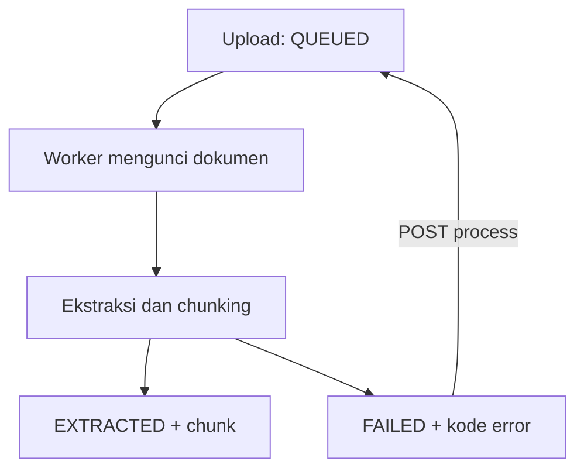

# Tahap 4 — Ekstraksi teks dan chunking Java

> Arsip tahap 4. Indexing tersedia pada tahap 5; lihat tahap-5.md.

Tahap ini mengubah dokumen asli menjadi potongan teks yang dapat dipakai pada RAG
berikutnya. Semua pemrosesan aplikasi menggunakan Java. Tidak ada Python,
panggilan Gemini, atau embedding pada tahap ini.

## Rancangan

Upload tetap mengembalikan 201 sesudah file dan metadata tersimpan. Status awal
sekarang QUEUED. Worker Java membaca antrean PostgreSQL secara berkala, memeriksa
integritas file, mengekstrak teks, membuat chunk, lalu menyimpan hasil.

Tabel documents menjadi antrean sederhana; tidak perlu Redis atau broker terpisah
untuk skala portfolio. Satu instance aplikasi memproses satu dokumen per giliran.
Chunk memiliki document_id, owner_id, urutan, dan halaman PDF.



Status EXTRACTED berarti teks sudah disiapkan, bukan siap menjawab dengan AI.
READY tetap disediakan untuk tahap indexing berikutnya.

## Transaksi dan antrean

DocumentProcessor membuka satu transaksi. SELECT FOR UPDATE SKIP LOCKED memilih
satu dokumen QUEUED milik akun aktif. Worker lain melewati baris yang sedang dikunci.
Status PROCESSING ditulis dalam transaksi tersebut, lalu hasil akhir dan chunk
di-commit bersama.

Karena transaksi yang sama dipertahankan, client biasanya melihat QUEUED lalu
EXTRACTED atau FAILED. PROCESSING tidak terlihat dari koneksi lain sebelum commit.
Ini sengaja dipilih agar tidak ada pekerjaan yang tertinggal sebagai PROCESSING
setelah proses mati. Saat transaksi batal, status awal QUEUED tetap ada.

Kegagalan ekstraksi yang dikenali menghasilkan FAILED tanpa chunk. Kegagalan
database dibiarkan membatalkan transaksi, sehingga giliran berikutnya dapat
mencoba kembali. Kegagalan database terus-menerus masih dapat menghambat antrean;
belum ada dead-letter queue.

Delete mengubah baris dokumen yang sama, sehingga menunggu worker yang memegang
lock. Setelah delete selesai, foreign key menghapus seluruh chunk. Worker tidak
dapat menyimpan chunk untuk dokumen yang sudah dihapus.

Tradeoff: transaksi dan satu koneksi database tetap terbuka selama ekstraksi.
Pilihan ini sederhana untuk skala kecil; pekerjaan besar nantinya perlu antrean
dengan lease dan worker terpisah. Timeout ekstraksi bersifat kooperatif pada
checkpoint/write, bukan pemutus paksa parser yang sedang macet.

## Ekstraksi per format

| Format | Isi yang diproses | Sumber |
|---|---|---|
| PDF | Text layer melalui PDFBox, diurutkan berdasarkan posisi | Halaman fisik mulai 1 |
| DOCX | Paragraf, tabel termasuk tabel dalam sel, dan content control pada body utama | sourceSection=1, pageNumber=null |
| TXT | Teks UTF-8 | sourceSection=1, pageNumber=null |

PDF diproses halaman demi halaman. Halaman kosong tidak menjadi chunk; halaman
setelahnya tetap memakai nomor asli. Nomor ini posisi halaman file, bukan label
cetak seperti i, ii, atau halaman 10.

DOCX tidak memiliki pembagian halaman tetap tanpa mesin layout. Header/footer,
catatan kaki, komentar, text box kompleks, serta isi gambar belum dicakup.
Tabel diratakan menjadi teks sesuai urutan baris/sel; struktur visual tidak dipertahankan.

PDF scan tanpa text layer tidak menghasilkan teks. Dokumen tersebut gagal dengan
NO_EXTRACTABLE_TEXT; OCR belum tersedia. PDF campuran gambar/teks hanya menyimpan
teks yang berhasil dibaca, sehingga isi gambar tidak terwakili. Layout multikolom
dan font khusus juga dapat memengaruhi urutan/akurasi teks.

Teks dinormalisasi: CRLF/CR menjadi newline, BOM dihapus, karakter kontrol selain
newline/tab dibuang, whitespace awal/akhir dibersihkan. Isi tidak diringkas atau
ditulis ulang oleh AI.

## Chunking

TextChunker memakai jendela berukuran tetap, default 1000 Unicode code point,
dengan overlap 150. Code point dipakai agar pasangan UTF-16 untuk emoji tidak
terpotong. Grapheme gabungan dan batas kata/kalimat belum menjadi aturan pemisahan.

Contoh posisi untuk teks panjang: chunk pertama 0–999, berikutnya mulai 850,
kemudian 1700. Bagian akhir boleh lebih pendek. Tidak ada overlap antarhalaman PDF.
Jika batas ukuran/jumlah terlampaui, seluruh dokumen gagal, bukan dipotong diam-diam.

extractedCharacters menghitung teks hasil normalisasi sebelum overlap.
characterCount pada chunk menghitung isi chunk tersebut. Jumlah characterCount
seluruh chunk bisa lebih besar karena overlap.

## Database dan migrasi V4

V4__create_document_chunks.sql:

- Menambahkan EXTRACTED pada constraint status.
- Mengubah status default menjadi QUEUED dan mengantrekan dokumen lama UPLOADED.
- Menambah ringkasan hasil pemrosesan pada documents.
- Membuat tabel document_chunks, indeks antrean, dan indeks kepemilikan.

| Kolom documents yang baru | Fungsi |
|---|---|
| chunk_count | Jumlah potongan yang berhasil disimpan |
| extracted_characters | Jumlah code point teks sebelum overlap |
| source_pages | Jumlah halaman PDF; null untuk DOCX/TXT |
| processed_at | Waktu selesai atau gagal |
| processing_error | Kode kegagalan yang aman; null saat tidak gagal |

| Kolom document_chunks | Fungsi |
|---|---|
| id | UUID chunk buatan server |
| document_id, owner_id | Mengacu ke dokumen dan pemilik yang sama |
| chunk_index | Urutan global mulai 0 dalam dokumen |
| source_section | Nomor bagian sumber mulai 1; halaman asli untuk PDF |
| page_number | Halaman PDF atau null |
| content | Teks chunk |
| character_count | Jumlah Unicode code point |

Foreign key gabungan ke documents(id,owner_id) mencegah chunk memakai pemilik
yang tidak sesuai. ON DELETE CASCADE membersihkan chunk setelah metadata dihapus.
UNIQUE(document_id,chunk_index) mencegah urutan duplikat.

Tidak ada kolom vector atau panggilan embedding baru pada tahap ini. Teks chunk
disimpan di PostgreSQL dan harus ikut dilindungi dalam backup database.

## Package dan class baru

Package com.documind.processing memisahkan ekstraksi/chunking dari upload.

| Class | Tanggung jawab |
|---|---|
| ProcessingProperties | Record konfigurasi, batas nilai dan validasi overlap |
| ProcessingConfig | Mengaktifkan binding konfigurasi app.processing |
| ExtractionFailure | Exception dengan kode yang boleh ditampilkan ke pengguna |
| ExtractedText | Record daftar Section dan jumlah halaman sumber |
| DocumentExtractor | Membaca teks dengan PDFBox/POI atau UTF-8 |
| TextChunker | Membagi teks dan menjaga metadata sumber |
| ChunkRepository | Menulis/membaca chunk di PostgreSQL |
| DocumentProcessor | Mengelola transaksi satu pekerjaan |
| ProcessingScheduler | Memanggil processor secara berkala bila diaktifkan |

Constructor setiap service/component menerima dependensi dari Spring.
Record menyediakan constructor dan accessor sesuai nama field secara otomatis.

## Method baru dan fungsinya

| Class dan method | Penjelasan |
|---|---|
| ProcessingProperties.isOverlapValid | Memastikan overlap lebih kecil dari chunkSize |
| ExtractionFailure.code | Mengembalikan kode kegagalan tanpa path atau teks dokumen |
| ExtractedText.Section | Menyimpan nomor bagian, halaman, dan teks |
| ExtractedText.toString / Section.toString | Hanya ringkasan jumlah/nomor, tidak mencetak isi |
| DocumentExtractor.extract | Memilih parser sesuai format dan menyamarkan pesan error parser |
| DocumentExtractor.pdf | Membaca setiap halaman PDF dengan PDFTextStripper dan Writer terbatas |
| DocumentExtractor.docx | Membuka Word lalu menelusuri body |
| DocumentExtractor.appendBody | Menelusuri paragraf, tabel, sel, dan content control; batas nesting 20 |
| DocumentExtractor.normalize | Membersihkan line ending, BOM, dan karakter kontrol |
| Budget.constructor | Membuat batas karakter serta deadline |
| Budget.check | Memeriksa timeout kooperatif dan interupsi |
| Budget.take | Mengurangi sisa anggaran teks; gagal jika terlampaui |
| LimitedWriter.write | Memeriksa anggaran sebelum menambahkan teks ke StringBuilder |
| LimitedWriter.flush / close | Tidak melakukan IO karena penampung ada di memori |
| LimitedWriter.toString | Memberikan teks kepada extractor; tidak dipakai untuk logging |
| TextChunker.split | Memotong code point, menambahkan overlap, mempertahankan sumber, membatasi jumlah |
| TextChunker.Chunk | Record hasil chunking; toString hanya mencetak indeks |
| ChunkRepository.replace | Menghapus hasil lama lalu batch INSERT dalam transaksi processor |
| ChunkRepository.list | Query dengan document_id, owner_id, dan status EXTRACTED; hasil bertingkat halaman |
| ChunkResponse / ChunkPage | DTO isi chunk dan halaman daftar; toString chunk tidak mencetak isi |
| DocumentProcessor.processNext | Memilih pekerjaan, memeriksa SHA-256, mengekstrak, membuat chunk, dan menyimpan status akhir |
| ProcessingScheduler.poll | Menjalankan satu pekerjaan per giliran; mencatat jenis kegagalan tanpa data sensitif |

## Perubahan class tahap sebelumnya

| Class dan method | Perubahan |
|---|---|
| DocumentRecord | Menambah statistik, waktu, dan kode error pemrosesan |
| DocumentResponse.from | Memetakan statistik ke metadata publik |
| DocumentRepository.lockNextQueued | Mengunci satu pekerjaan QUEUED dengan SKIP LOCKED |
| DocumentRepository.lockOwned | Mengunci dokumen milik pengguna saat retry |
| DocumentRepository.queue | Mengantrekan ulang dan membersihkan error/waktu lama |
| DocumentRepository.markProcessing | Mengubah status di dalam transaksi aktif |
| DocumentRepository.markFailed | Menyimpan kode error dan statistik kosong |
| DocumentRepository.markExtracted | Menyimpan statistik hasil dan waktu selesai |
| DocumentRepository.mapRow | Membaca semua kolom baru; waktu/halaman nullable |
| DocumentService.retry | Memeriksa pemilik dan status; FAILED boleh retry, QUEUED idempotent |
| DocumentController.retry | Menyediakan POST process dengan respons 202 |
| DocumentController.chunks | Validasi halaman, kepemilikan, kesiapan, lalu mengambil chunk |
| SecurityConfig.securityFilterChain | Menambahkan izin endpoint chunks/process bagi pengguna terautentikasi |

Constructor DocumentController juga menerima ChunkRepository.
Pemilik selalu diambil dari JWT; tidak ada pengecualian akses untuk ADMIN.

## Endpoint

Endpoint upload/detail/list/download/delete sebelumnya tetap tersedia.
Respons metadata sekarang memiliki chunkCount, extractedCharacters, sourcePages,
processedAt, dan processingError.

| Method/path | Fungsi | Respons |
|---|---|---|
| GET /api/documents/{id} | Melihat progres/statistik | 200 metadata |
| GET /api/documents/{id}/chunks?page=0&size=20 | Membaca chunk sendiri | 200 daftar, 409 bila teks belum siap |
| POST /api/documents/{id}/process | Mencoba ulang dokumen FAILED | 202 QUEUED |

POST process tidak membutuhkan body. Bila sudah QUEUED, tetap 202 tanpa membuat
pekerjaan kedua. EXTRACTED tidak diproses ulang lewat endpoint ini (409).
DELETING atau dokumen pengguna lain mendapat 404. Token tidak valid mendapat 401.
Page mulai 0 hingga 100000; size 1–100.

Contoh PowerShell sesudah login tahap 2 dan upload tahap 3:

```powershell
$headers = @{ Authorization = "Bearer $token" }
$id = 'UUID-DOKUMEN'
Invoke-RestMethod "http://localhost:8080/api/documents/$id" -Headers $headers
# Setelah status EXTRACTED:
Invoke-RestMethod "http://localhost:8080/api/documents/$id/chunks?page=0&size=20" -Headers $headers
# Jika status FAILED dan penyebab sudah diperbaiki:
Invoke-RestMethod -Method Post "http://localhost:8080/api/documents/$id/process" -Headers $headers
```

| processingError | Arti/tindakan |
|---|---|
| NO_EXTRACTABLE_TEXT | Tidak ada teks terbaca; untuk PDF scan diperlukan OCR yang belum tersedia |
| FILE_UNAVAILABLE | File hilang/tidak terbaca; pulihkan file asli lalu retry |
| FILE_INTEGRITY_ERROR | Ukuran/SHA-256 berubah; pulihkan file asli, jangan mengganti hash sembarangan |
| TEXT_TOO_LARGE | Batas hasil ekstraksi terlampaui |
| TOO_MANY_CHUNKS | Hasil memerlukan terlalu banyak chunk |
| PROCESSING_TIMEOUT | Deadline terlewati pada checkpoint |
| DOCUMENT_TOO_COMPLEX | Kedalaman tabel DOCX melebihi batas |
| ENCRYPTED_PDF | PDF terenkripsi tidak didukung |
| EXTRACTION_FAILED | Parser gagal; periksa format dokumen |
| UNSUPPORTED_FILE | Format tidak tersedia pada extractor |

## Konfigurasi

| Environment | Default | Batas/perilaku |
|---|---|---|
| PROCESSING_ENABLED | true | false menghentikan scheduler; upload masih QUEUED |
| PROCESSING_POLL_DELAY_MS | 1000 | Jeda setelah satu giliran selesai |
| CHUNK_SIZE | 1000 | 100–4000 code point |
| CHUNK_OVERLAP | 150 | 0 hingga kurang dari CHUNK_SIZE |
| MAX_EXTRACTED_CHARACTERS | 2000000 | 100–5000000 unit UTF-16 mentah sebelum normalisasi |
| MAX_CHUNKS | 3000 | 1–10000 per dokumen |
| PROCESSING_TIMEOUT_SECONDS | 60 | 1–300; timeout kooperatif |

Ubah .env lalu jalankan docker compose up -d --build --wait.
Batas chunk/overlap/karakter/jumlah/timeout divalidasi ketika startup supaya konfigurasi yang salah
tidak berjalan diam-diam. Jangan menurunkan CHUNK_SIZE di bawah overlap tanpa
menyesuaikan CHUNK_OVERLAP.

## Pengujian dan batas

ExtractionTest memakai PDF/DOCX buatan Java untuk memeriksa urutan, halaman,
Unicode, overlap, dan batas. InfrastructureIT memakai database pgvector asli;
scheduler otomatis dimatikan agar test dapat memanggil processNext secara deterministik.
Verifikasi Compose memakai scheduler sungguhan.

Belum ada OCR, chunk berbasis token/model, semantic chunking, embedding,
vector search, Gemini, chat, atau frontend. Kutipan AI akan ditambahkan setelah
chunk diindeks. Jangan menafsirkan EXTRACTED sebagai jaminan semua isi visual
dokumen berhasil dibaca.

## Referensi

- PDFBox 3 FAQ, urutan ekstraksi dan keterbatasan PDF scan:
  https://pdfbox.apache.org/3.0/faq.html
- API PDFBox 3.0.8, PDFTextStripper:
  https://javadoc.io/static/org.apache.pdfbox/pdfbox/3.0.8/org/apache/pdfbox/text/PDFTextStripper.html
- API POI, XWPFDocument/getBodyElements:
  https://poi.apache.org/apidocs/dev/org/apache/poi/xwpf/usermodel/XWPFDocument.html

Versi dependency tetap PDFBox 3.0.8 dan POI 5.5.1 dari tahap 3.
