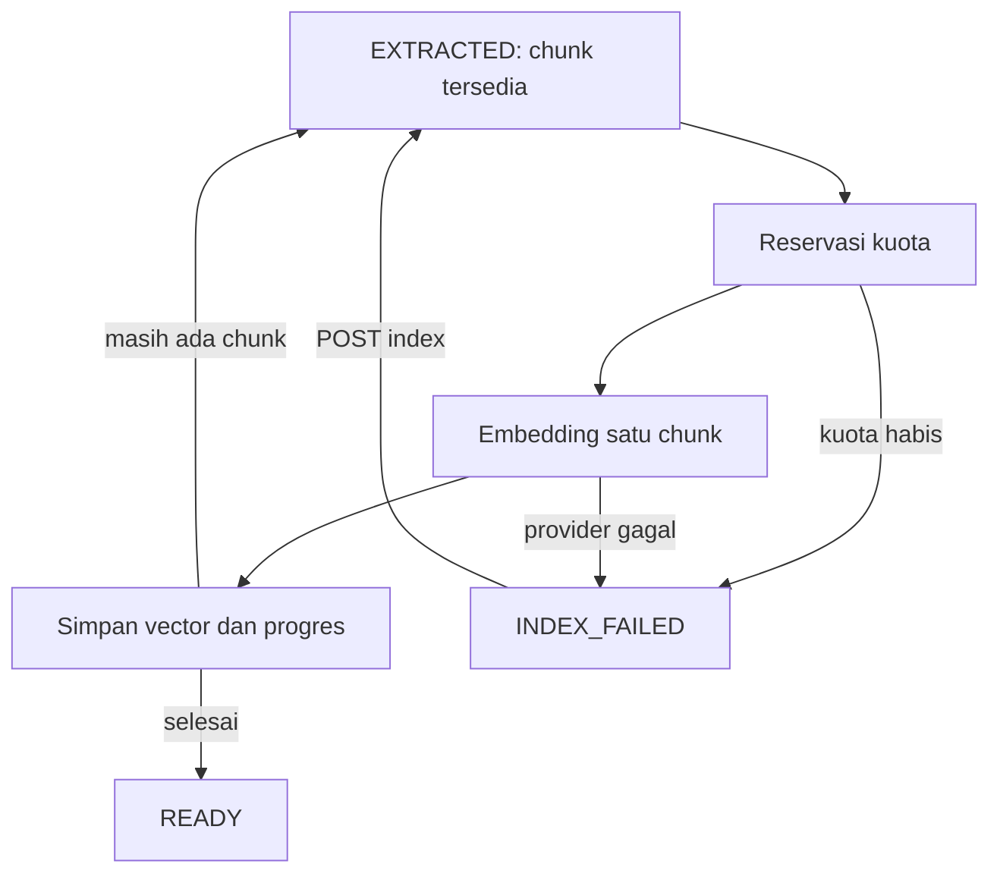

# Tahap 5 — Embedding Gemini dan penyimpanan indeks pgvector

Tahap ini menyiapkan vector embedding dari chunk yang sudah dibuat pada tahap 4.
Semua pemrosesan aplikasi tetap Java. API key hanya dibaca backend dari environment.

**Status aktivasi:** Gemini sudah aktif pada lingkungan lokal. Uji satu dokumen
ke provider sungguhan berhasil menghasilkan vector 768 dimensi. Untuk instalasi
baru, .env.example tetap memakai key kosong dan EMBEDDING_ENABLED=false.
Tes otomatis memakai HTTP lokal/model tiruan; uji provider terpisah dicatat
di hasil-verifikasi-tahap-5.md. Kualitas retrieval belum dievaluasi.

## Arsitektur

Upload → ekstraksi → EXTRACTED → indexing per chunk → READY.
READY berarti seluruh chunk dokumen memiliki embedding. Endpoint AI Chat dan
pencarian semantik belum ditambahkan pada tahap ini.

IndexingScheduler memanggil IndexingService berkala. Service mengunci satu
dokumen EXTRACTED milik akun aktif, mengambil satu chunk tanpa embedding,
mereservasi kuota, memanggil EmbeddingModel Spring AI, lalu menyimpan vector
dan statistik dalam satu transaksi. Vector dinormalisasi sebelum disimpan.

Satu giliran mengerjakan satu chunk. Dokumen panjang tidak mengharuskan semua
panggilan berhasil sekaligus. Chunk yang sudah berhasil tidak dipanggil ulang
ketika retry. Semua chunk selesai → READY dan indexedAt terisi.



## Versi, model, dan adapter Spring AI

- Java 21, Spring Boot 3.5.16, Spring AI BOM 1.1.8 tetap dipakai.
- Modul spring-ai-google-genai-embedding 1.1.8 membawa Google GenAI SDK 1.37.0.
- Model teks dikunci menjadi gemini-embedding-001.
- Dimensi 768 dan task RETRIEVAL_DOCUMENT ditetapkan oleh backend.
- Vector berdimensi 768 dinormalisasi L2 sebelum disimpan.
- Model/dimensi tidak menjadi pilihan client. Menggantinya memerlukan migrasi
  dan pembuatan ulang vector agar satu indeks tidak mencampur ruang embedding.

Source artifact Spring AI 1.1.8 diperiksa. GoogleGenAiTextEmbeddingModel pada versi
tersebut meneruskan outputDimensionality, tetapi belum memasukkan taskType ke
EmbedContentConfig meskipun opsinya tersedia. Karena itu GeminiEmbeddingModel
mengimplementasikan antarmuka EmbeddingModel Spring AI dan memanggil SDK Google
dengan taskType eksplisit. Ini adapter aplikasi, bukan class model bawaan Spring AI.

Pengujian HTTP memastikan body request benar. SDK menggunakan endpoint
batchEmbedContents dengan satu input per request. Adapter tidak memakai
HTTP buatan sendiri dan tidak memakai Python.

Starter auto-configuration tidak ditambahkan; bean Client dan EmbeddingModel
dibuat manual hanya saat fitur aktif. Ini memungkinkan aplikasi tetap berjalan
tanpa key pada tahap pengembangan.

## Database V5

Migrasi V5__add_chunk_embeddings.sql menambahkan:

| Tabel/kolom | Kegunaan |
|---|---|
| document_chunks.embedding | VECTOR(768), null sebelum berhasil |
| document_chunks.embedding_model | Nama model; harus cocok dengan vector |
| documents.indexed_chunk_count | Jumlah chunk yang sudah berhasil |
| documents.indexed_at | Waktu semua chunk selesai |
| documents.indexing_error | Kode kegagalan indexing yang aman |
| embedding_daily_usage.usage_day | Tanggal UTC |
| embedding_daily_usage.scope | application atau owner:UUID |
| embedding_daily_usage.reserved_characters | Total karakter yang sudah direservasi |

Status INDEX_FAILED ditambahkan tanpa mengubah status FAILED ekstraksi.
Constraint menjaga pasangan vector/model. Relasi chunk→dokumen tahap 4 tetap
menghapus vector bersama chunk saat dokumen dihapus.

Tahap ini menggunakan penyimpanan vector pgvector, belum indeks ANN seperti HNSW.
Untuk skala kecil, pencarian exact dengan filter pemilik akan menjadi baseline
tahap retrieval. Vector tidak dikirim ke frontend atau endpoint metadata.

## Kuota dan biaya

Default batas harian aplikasi 200000 code point; per pengguna 50000 code point.
Hitungan mencakup overlap karena isi chunk itulah yang dikirim. Ini pembatas
volume input, bukan penghitung token atau estimasi biaya tagihan provider.

EmbeddingBudget.reserve membuka transaksi REQUIRES_NEW. Reservasi global dan
pemilik harus sama-sama berhasil sebelum API dipanggil. Jika kuota pemilik
ditolak, reservasi global dalam transaksi tersebut ikut dibatalkan.

Reservasi yang sudah commit tidak dikembalikan ketika provider gagal, timeout,
atau transaksi vector rollback. Provider mungkin sudah memproses request
meskipun aplikasi tidak menerima hasil. Perilaku ini menghindari pemakaian
berulang yang tidak tercatat.

SDK dibatasi satu attempt. Tidak ada retry otomatis pada kegagalan provider.
Status menjadi INDEX_FAILED dan pemilik dapat meminta retry. Retry akan
mereservasi kuota lagi. Kuota harian memakai tanggal UTC dan otomatis memakai
baris baru pada hari berikutnya; INDEX_FAILED tetap memerlukan retry eksplisit.

Tabel kuota tidak memiliki foreign key akun agar penghapusan akun tidak mengurangi
penggunaan aplikasi yang sudah terjadi. Retensi/pembersihan histori kuota belum
otomatis. Tabel ini menyimpan UUID scope dan angka, tanpa isi dokumen atau API key.

## Transaksi dan pemulihan

FOR UPDATE SKIP LOCKED pada baris dokumen mencegah dua worker mengirim chunk
dokumen yang sama secara bersamaan. Lock dipertahankan selama satu request SDK
(default timeout 20 detik). Delete menunggu lock lalu menghapus dokumen/chunk.

Kegagalan provider atau vector invalid: status INDEX_FAILED, hasil chunk sebelumnya
tetap ada. POST index mengubahnya kembali menjadi EXTRACTED. Chunk yang belum
memiliki vector diproses berikutnya.

Kegagalan database: transaksi vector/progres rollback; status tetap EXTRACTED.
Reservasi kuota tetap dihitung. Jika Google sudah berhasil sebelum database gagal,
request dapat terulang pada giliran berikutnya. Exactly-once billing tidak dijamin.

Belum ada backoff otomatis, circuit breaker, atau antrean terpisah. Satu instance
memproses satu chunk per giliran dan memakai koneksi database selama request.
Reservasi kuota membutuhkan koneksi kedua; pool default lima koneksi tetap digunakan.

## Package, class, dan method

Package com.documind.indexing mengelompokkan integrasi embedding.
Constructor component menerima dependensi melalui Spring. Record menyediakan
constructor/accessor Java secara otomatis.

| Class/method | Fungsi |
|---|---|
| IndexingProperties | Konfigurasi enabled, apiKey, timeout, dan dua batas harian; konstanta model/dimensi |
| IndexingProperties.isKeyConfigured | Menolak aktivasi bila key kosong |
| IndexingProperties.toString | Menyembunyikan nilai key |
| IndexingConfig.embeddingClient | Membuat SDK Client mode Gemini Developer API, timeout terbatas dan satu attempt |
| IndexingConfig.embeddingModel | Mendaftarkan adapter sebagai bean EmbeddingModel Spring AI |
| GeminiEmbeddingModel.call | Memvalidasi satu input, mengirim task/dimensi, membaca satu vector dan menolak statistik truncated jika tersedia |
| GeminiEmbeddingModel.embed(Document) | Mengambil teks Document lalu memakai kontrak embed Spring AI |
| GeminiEmbeddingModel.dimensions | Mengembalikan 768 tanpa panggilan API |
| EmbeddingGateway.embed | Mengambil bean model, memanggil embedding, dan menyamarkan error provider |
| EmbeddingGateway.normalize | Memeriksa 768 nilai finite, menolak zero vector, lalu normalisasi L2 |
| EmbeddingBudget.reserve | Reservasi kuota global dan pemilik dalam transaksi baru |
| EmbeddingBudget.take | INSERT/UPSERT atomik dengan batas agar request paralel tidak melewati kuota |
| IndexRepository.lockNext | Mengunci satu dokumen EXTRACTED milik akun aktif |
| IndexRepository.nextChunk | Memilih chunk milik dokumen/pemilik yang embedding-nya null |
| IndexRepository.save | Menulis vector/model dengan parameter SQL dan filter chunk/dokumen/pemilik |
| IndexRepository.refresh | Menghitung progres dan menetapkan EXTRACTED atau READY |
| IndexRepository.failed | Menyimpan INDEX_FAILED dan kode aman |
| IndexRepository.Job | Record ID dokumen dan pemilik untuk worker |
| IndexRepository.Input | Record ID/isi/jumlah karakter chunk; toString hanya menampilkan ID |
| IndexingService.processNext | Menjalankan satu giliran indexing; tidak bekerja bila fitur nonaktif |
| IndexingService.retry | Memeriksa pemilik, aktivasi, dan status sebelum mengantrekan ulang |
| IndexingScheduler.poll | Memanggil service berkala; hanya mencatat jenis exception |
| IndexingFailure.code | Mengembalikan kode kegagalan aman |

Perubahan class lama:

| Class/method | Perubahan |
|---|---|
| DocumentRecord dan DocumentResponse | Tambahan indexedChunkCount, indexedAt, indexingError |
| DocumentResponse.from | Memetakan statistik indexing tanpa membocorkan vector/key |
| DocumentRepository.queueIndex | Mengubah status menjadi EXTRACTED dan menghapus indexingError |
| DocumentRepository.mapRow | Membaca kolom baru, termasuk waktu nullable |
| DocumentController.retryIndex | Menghubungkan POST index ke service dan mengirim 202 |
| DocumentController.chunks | Teks tetap tersedia pada EXTRACTED, INDEX_FAILED, dan READY |
| ChunkRepository.list | Query chunk mendukung ketiga status tersebut |
| SecurityConfig.securityFilterChain | Mengizinkan POST index hanya setelah autentikasi |

## Endpoint dan status

Endpoint baru: POST /api/documents/{id}/index, tanpa body, membutuhkan Bearer JWT.

| Kondisi | Respons |
|---|---|
| EXTRACTED / INDEX_FAILED dan fitur aktif | 202, status EXTRACTED |
| Fitur nonaktif, dokumen milik sendiri | 503 EMBEDDING_DISABLED |
| Status tidak dapat diindeks ulang, termasuk READY | 409 INDEX_NOT_RETRYABLE |
| Dokumen tidak ada/milik orang lain/DELETING | 404 |
| Token tidak valid/tidak ada | 401 |

EXTRACTED sudah masuk antrean otomatis saat embedding aktif; endpoint terutama
untuk mencoba ulang INDEX_FAILED. Tidak ada endpoint yang menerima ownerId,
API key, model, atau vector dari client.

GET /api/documents/{id} dan daftar dokumen kini memuat statistik indexing.
indexedChunkCount bisa lebih kecil dari chunkCount selama progres/gagal parsial.
GET chunks tetap mengembalikan teks dan sumber, tanpa angka vector.

| indexingError | Arti |
|---|---|
| EMBEDDING_DAILY_LIMIT | Kuota harian aplikasi/pengguna habis |
| EMBEDDING_PROVIDER_ERROR | SDK/provider gagal; pesan mentah tidak dipublikasikan |
| INVALID_EMBEDDING | Jumlah/dimensi/nilai vector tidak valid |
| EMBEDDING_INPUT_TRUNCATED | Provider melaporkan input terpotong |
| INVALID_EMBEDDING_INPUT | Input internal tidak sesuai kontrak satu chunk |
| EMBEDDING_DISABLED | Model tidak tersedia |
| NO_CHUNKS_TO_INDEX | Kondisi metadata/chunk tidak sesuai; perlu pemeriksaan |

## Mengaktifkan dengan key milik aplikasi

Isi langsung file .env lokal. Jangan mengirim key melalui chat, frontend, Git,
atau contoh dokumentasi.

```dotenv
GEMINI_API_KEY=isi_key_anda_di_file_lokal
EMBEDDING_ENABLED=true
```

Kemudian recreate backend:

```powershell
docker compose up -d --build --wait
```

Ketika diaktifkan, chunk dokumen EXTRACTED (termasuk dokumen lama) akan dikirim ke
Gemini secara otomatis. File asli, email, password, dan JWT tidak dikirim;
request berisi teks chunk, model, task, dan dimensi. Pemakaian menggunakan kuota
dan akun API pemilik aplikasi.

Periksa metadata sampai READY atau INDEX_FAILED. Untuk retry:

```powershell
$headers = @{ Authorization = "Bearer $token" }
Invoke-RestMethod "http://localhost:8080/api/documents/$id" -Headers $headers
Invoke-RestMethod -Method Post "http://localhost:8080/api/documents/$id/index" -Headers $headers
```

| Environment | Default |
|---|---|
| GEMINI_API_KEY | kosong |
| EMBEDDING_ENABLED | false |
| EMBEDDING_TIMEOUT_MS | 20000, rentang 1000–120000 |
| EMBEDDING_POLL_DELAY_MS | 1000, jeda setelah satu giliran selesai |
| EMBEDDING_DAILY_CHARACTERS | 200000, minimal 1 |
| EMBEDDING_USER_DAILY_CHARACTERS | 50000, minimal 1 |

Konfigurasi API key terpisah dari JWT_SECRET. Mengganti key Gemini tidak membuat
JWT pengguna berubah. Jangan menjalankan docker compose config tanpa --quiet
pada log yang akan dibagikan karena environment dapat terlihat.

## Verifikasi dan batas tahap

GeminiAdapterTest memakai SDK Google asli ke server HTTP lokal dengan key dummy.
InfrastructureIT memakai EmbeddingModel tiruan dan PostgreSQL/pgvector sungguhan.
Tes membuktikan kontrak request, mekanisme penyimpanan, normalisasi, status, kuota,
retry, dan akses. Tes ini tidak mengukur relevansi semantik, quota akun Google,
biaya nyata, maupun penerimaan key oleh Google.

Belum ada AI Chat, retrieval endpoint, embedding pertanyaan RETRIEVAL_QUERY,
frontend, atau pemilihan model oleh pengguna. Tahap berikutnya adalah retrieval
dan jawaban RAG bersumber. Aktivasi dan satu uji provider sungguhan sudah berhasil.

## Referensi resmi dan source yang diperiksa

- Spring AI 1.1.8, konfigurasi embedding:
  https://docs.spring.io/spring-ai/reference/1.1/api/embeddings/google-genai-embeddings-text.html
- Source artifact 1.1.8 yang diperiksa untuk taskType:
  https://repo.maven.apache.org/maven2/org/springframework/ai/spring-ai-google-genai-embedding/1.1.8/spring-ai-google-genai-embedding-1.1.8-sources.jar
- Google Gemini embedding, task dan normalisasi dimensi:
  https://ai.google.dev/gemini-api/docs/embeddings
- Source SDK 1.37.0 untuk endpoint, retry, dan timeout:
  https://repo.maven.apache.org/maven2/com/google/genai/google-genai/1.37.0/google-genai-1.37.0-sources.jar
